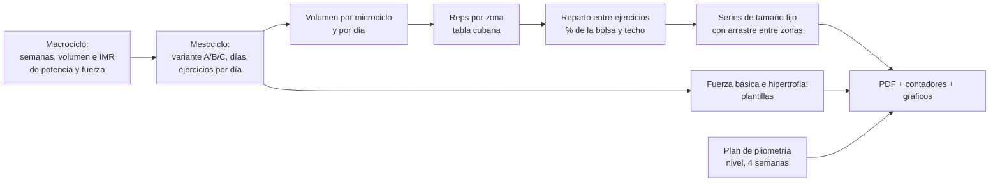

# RUTINEITOR

Programa de escritorio para programar mesociclos de sobrecarga con el **método cubano de distribución de repeticiones** (H. Anselmi, *Actualizaciones sobre el entrenamiento de la potencia*, cap. 8). Reemplaza la planilla `Rutina.xlsx`: a partir del volumen y la intensidad que planificás para cada mesociclo, calcula solo las series × repeticiones × kg de cada ejercicio, con series parejas (escalera de peso) y contadores que muestran cuánto se aparta de la teoría. Exporta un PDF con el formato de la planilla del entrenador para llevar al gimnasio.

## Qué tiene

- **Ejercicios:** potencia, fuerza, hipertrofia y pliometría. Cada ejercicio tiene una ficha con su 1RM, el objetivo, el techo de intensidad, las repeticiones por serie propias de cada zona y un gráfico de cómo evoluciona su 1RM.
- **Plantillas:** las tablas del método (microciclos, días, distribución por intensidad, repeticiones por serie, plantillas de fuerza básica e hipertrofia, volúmenes de pliometría). Son editables, con un botón para restaurar los valores originales.
- **Macrociclo:** calendario del año con los mesociclos y los planes de pliometría, más el gráfico anual de volumen e intensidad.
- **Mesociclo:** la grilla de días y ejercicios, con las series que se calculan solas, los contadores, el gráfico teoría vs planilla y el botón **Exportar PDF**.
- **Perfiles:** cada persona tiene sus propios ejercicios, 1RM y mesociclos. Las plantillas son compartidas.
- **Progreso y Registro:** lo que entrenaste de verdad (anotado en la app del celular) comparado con la planilla.

## Registro desde el celular

La app del celular es una app nativa de Android (código en [`android/`](android/)), instalada desde la PC por cable: no usa Play Store, servicios de Google ni internet. Guarda todo en el almacenamiento interno de la app (`com.rutina.app`).

1. En la PC, pestaña **Mesociclo → Plan al celular**: guarda un `.json` con el plan. Pasalo al celular (WhatsApp a vos mismo, Drive, cable a Descargas).
2. En el celular, tocá el archivo y elegí RUTINEITOR en **Compartir** o **Abrir con**, o en la app **Planes → Cargar archivo**. Después elegís microciclo y día en **Sesión** y anotás; se guarda sola.
3. Al terminar el mesociclo (o cuando quieras), **Exportar → Compartir registro** o **Guardar en Descargas**, y pasá ese `.json` a la PC.
4. En la PC, **Mesociclo → Importar registro**. La pestaña **Registro** muestra Planilla vs Entrenado.

Compilar e instalar la app (necesita las herramientas de línea de comandos del SDK de Android en `~/Android/Sdk`, `android/local.properties` con `sdk.dir=…` y el celular con depuración USB):

```bash
cd android && ./gradlew test installDebug
```

## Panel

RUTINEITOR puede mandar lo que entrenás al **Panel**, el servidor personal donde se junta la actividad de gimnasio, running, estudio y demás (repo `Panel`). Es opcional: sin configurar, el programa funciona igual que siempre.

### Qué se manda y cuándo

- **Al tocar Importar registro** (pestaña Mesociclo): se manda **cada sesión del archivo** que se importa, aunque sea anterior a la conexión. En el panel queda como una sesión de gimnasio con el esfuerzo del día ("cómo terminé"), la duración y el detalle por ejercicio: lo planificado contra lo hecho, el texto del esfuerzo de cada ejercicio y un aviso si bajaste series, repeticiones o peso o si una casilla no se pudo leer.
- **Una sesión sin duración no se manda**, porque el panel la necesita para sumar minutos. Tampoco se manda la que no está en el plan. El aviso que muestra la importación dice cuántas quedaron afuera.
- **Los 1RM se mandan cada vez que se guardan** (como resultado `1rm:<clave>`, para usarlos en las metas del panel). Si guardás otro 1RM el mismo día, gana el último.
- Reimportar el mismo archivo no duplica nada: cada sesión tiene un id estable y gana el envío más nuevo.
- **Solo se manda el primer perfil** (el de menor id, el tuyo). Los demás perfiles nunca se mandan.

### Cómo configurarlo

Menú **Panel → Conexión con el panel…** y completá:

- **Dirección del panel**, por ejemplo `http://192.168.1.13:7070`.
- **Token** del dispositivo (campo de contraseña; la casilla **Mostrar** lo deja ver; no se escribe en ningún mensaje).
- **Dispositivo** (por ejemplo `pc`; el servidor igual lo reemplaza por el del token).
- La casilla **Enviar al panel**, que se puede destildar para pausar el envío sin perder la configuración.

Los botones son **Probar conexión**, **Enviar historial de 1RM**, **Guardar** y **Cancelar**.

**Probar conexión** verifica la dirección y el token sin guardar. El botón **Enviar historial de 1RM** manda de una vez los 1RM que ya tenías guardados.

La ventana también lista las **claves de 1RM** de tus ejercicios: son las que se escriben en el campo "métrica" al crear una meta en el panel. La clave sale del nombre del ejercicio: minúsculas, sin tildes, y todo lo que no sea letra o número pasa a un guion (sin guiones en los extremos). Ejemplos: `Press banca` → `1rm:press-banca`, `Sentadilla frontal (barra)` → `1rm:sentadilla-frontal-barra`. Si dos ejercicios dan la misma clave, solo se manda el de menor id. Si renombrás un ejercicio, su clave cambia (`1rm:` más la clave nueva): los puntos ya enviados quedan con la clave vieja y una meta creada con esa clave deja de moverse. Usá **Enviar historial de 1RM** para reenviar todo el historial con la clave nueva y creá la meta de nuevo con ella.

### Dónde queda

Junto a la base de datos, en `~/.local/share/rutina/` (o `$XDG_DATA_HOME/rutina/`):

- `panel-cliente.properties`: URL, token, dispositivo y si se envía (permisos 600 cuando el sistema lo permite).
- `panel-cola.jsonl`: lo que todavía no llegó al panel. Solo existe si la conexión está activa.

Si no hay dirección o token, o la casilla está destildada, no se crea la cola, no se usa la red y no aparece ningún aviso.

### Cosas a tener en cuenta

- La carpeta de datos (`~/.local/share/rutina/`, con `panel-cola.jsonl`) no se debe sincronizar entre dos PCs ni abrir con dos instancias del programa a la vez: el archivo de la cola está protegido solo dentro de un proceso.
- Si cambiás la dirección del panel con registros pendientes, esos pendientes se mandan a la dirección nueva.
- Una sesión que quitaste de un archivo que importás de nuevo **no** se borra del panel.
- El programa descarta los registros que el servidor rechaza por inválidos (por ejemplo, con el reloj de la PC más de 24 horas adelantado) y solo deja una advertencia en el log. Importar el archivo otra vez los reenvía.

### Si el panel está apagado

La importación y el guardado locales no se enteran: lo que no se pudo entregar queda en `panel-cola.jsonl` y un hilo en segundo plano lo reintenta con espera creciente (5 segundos, duplicando hasta 15 minutos) hasta que el panel vuelva. Un token inválido tampoco interrumpe la importación. Los pendientes se reintentan también al abrir el programa de nuevo.

### Probar de punta a punta

Hay archivos de ejemplo en [`docs/ejemplos/`](docs/ejemplos/) (`plan-ejemplo.json` y `registro-ejemplo.json`, con una sesión bajada de series, una casilla ilegible, sesiones sin duración y una fuera del plan). La prueba `PanelExtremoAExtremoManualTest` los manda con las clases reales a un panel de verdad y verifica lo que quedó, la reimportación sin duplicados y el caso del panel caído. Solo corre si están definidas `PANEL_E2E_URL` y `PANEL_E2E_TOKEN`; con `mvn test` común se omite sola.

Levantar un panel de demostración (en el repo `Panel`; usa una base temporal en el puerto 8099 con token `demo`, y se detiene con Ctrl+C):

```bash
cd ~/Escritorio/Hobbies/programacion/Proyectos/Panel && scripts/demo.sh
```

Correr la prueba contra ese panel, desde otra terminal:

```bash
PANEL_E2E_URL=http://localhost:8099 PANEL_E2E_TOKEN=demo mvn test -Dtest=PanelExtremoAExtremoManualTest
```

## Descargar para Windows

[RUTINEITOR-windows.zip](RUTINEITOR-windows.zip) trae Java incluido: no hace falta instalar nada. Descomprimilo y abrí `Abrir RUTINEITOR.bat` (pasos en [LEEME.txt](LEEME.txt)).

### Regenerar el paquete de Windows

En el repo no hay un script que arme `RUTINEITOR-windows.zip`: se arma a mano. Contiene una carpeta `RUTINEITOR/` con `rutineitor.jar` (el `jar-with-dependencies` que deja `mvn package` en `target/rutineitor.jar`), la carpeta `jre` (el Java para Windows que viene incluido), `Abrir RUTINEITOR.bat` y `LEEME.txt`. **Hay que rehacer el zip después de la conexión con el panel**, porque el jar ahora incluye la librería `sync-core` (y Jackson, que trae adentro); el zip actual no la tiene.

## Requisitos

- Java 21
- Maven 3.9 (solo para compilar)

## Compilar, ejecutar y testear

Antes de compilar hace falta instalar en el Maven local la librería `panel:sync-core:1.0.0-SNAPSHOT`, que no está en ningún repositorio público: vive en el repo `Panel` (`~/Escritorio/Hobbies/programacion/Proyectos/Panel`, rama `main`). Las clases genéricas del cliente (conexión, contenedor compartido, validación y claves de ejercicio) vienen de `sync-core`, paquete `panel.cliente`. Desde la carpeta de ese repo:

```bash
mvn -q -pl sync-core -am install -DskipTests
```

En un clon limpio o en otra PC, `mvn package` falla con un error de `panel:sync-core` sin resolver hasta que se haga esto. Después, desde la carpeta de RUTINEITOR:

```bash
mvn package
```

```bash
java -jar target/rutineitor.jar
```

```bash
mvn test
```

## Dónde guarda los datos

En `~/.local/share/rutina/rutina.db` (o `$XDG_DATA_HOME/rutina/rutina.db` si esa variable está definida). Es un único archivo SQLite: para hacer una copia de seguridad alcanza con copiarlo. Si el archivo se daña, el programa lo renombra a `rutina.db.bak-<fecha>` y empieza uno nuevo; nunca lo pisa.

Los PDF se guardan donde elijas al exportar (por defecto, en `~/Documentos`).

## Cómo calcula



El detalle de cada regla está en [`docs/2026-10-21-generador-rutinas-design.md`](docs/2026-10-21-generador-rutinas-design.md).

## Estructura

- `com.rutina.model`: datos (ejercicio, mesociclo, metodología…).
- `com.rutina.service.calculo`: el motor de cálculo, sin interfaz ni base de datos, con tests.
- `com.rutina.service.datos`: SQLite y los datos iniciales de las planillas.
- `com.rutina.pdf`: el exportador.
- `com.rutina.ui`: la interfaz Swing.
